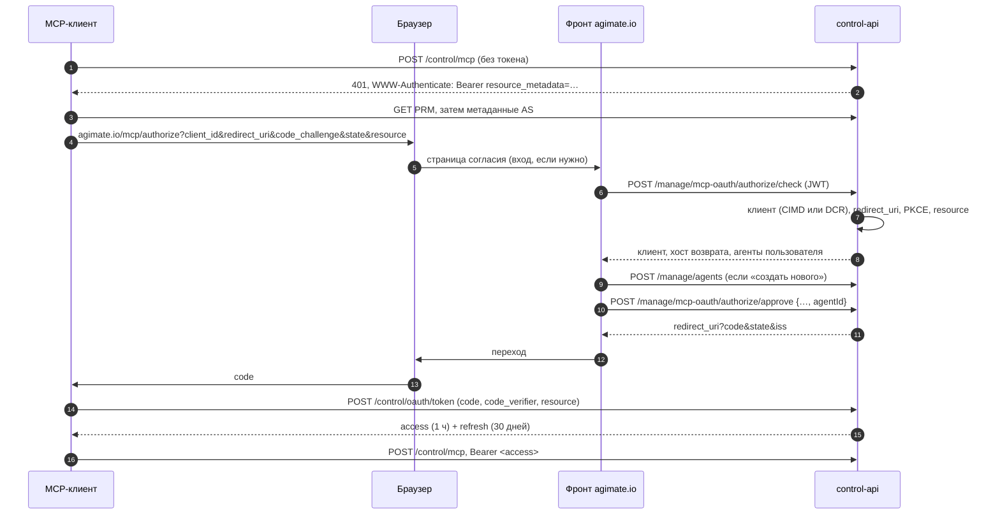

# OAuth на MCP-сервере: подключение по одной ссылке

> **Фаза 1 (CIMD) реализована на бэкенде 2026-10-12** — ветка `feature/mcp-server-oauth`. Впереди:
> страница согласия на фронте, правило ingress на проде, живой прогон с Claude и фаза 2 (DCR).

Решение о том, как внешний MCP-клиент (Claude, ChatGPT, Cursor, Claude Code, VS Code) получает доступ
к нашему `/mcp`, когда человек дал ему только адрес. Клиент находит сервер авторизации сам,
открывает браузер на нашем фронте, человек выбирает агента или заводит нового, и клиент уходит с
токеном, привязанным к этому агенту. Ключ `agnt…` копировать никуда не нужно.

Это **серверная** сторона. Клиентская — как наш коннектор `mcp` логинится в чужие серверы — описана в
[mcp-oauth.md](mcp-oauth.md), и многое отсюда повторяет её приёмы зеркально: страница на фронте,
состояние в базе, `PublicOnlyHttp` для чужих URL.

Документ пересматривает прежнее откладывание: в [../contracts/mcp-server.md](../contracts/mcp-server.md)
и roadmap стоял «client-credentials + PRM, только ради каталогов». Client-credentials задачу «отдать
только ссылку» не решает — у него нет браузера и выбора агента. Он остаётся дополнением для
безголовых клиентов и ложится поверх того же `/oauth/token` (см. «Отложено»).

## Что есть сейчас

- `/mcp` закрыт цепочкой `apiKeySecurityFilterChain` (`SecurityConfig`, `@Order(3)`) вместе с
  `/agent/**` и `/acp`. `AgentAuthFilter` берёт ключ из `X-Api-Key` или `Authorization: Bearer`,
  `AgentKeyAuthService` проверяет его (формат AGM → `keyId` → хэш) и ставит `AgentPrincipal`. Роли
  выводятся из типа агента: `MCP`, `CENTRIFUGO`, `WEBHOOK` получают `MCP_AGENT`, `GENERIC` — нет.
- Ответ на отсутствие ключа — общий `authenticationEntryPoint`: `401` с JSON-телом и **без**
  `WWW-Authenticate`. Клиенту не из чего начать discovery.
- У control-api `context-path: /control`, наружу он виден как `https://api.agimate.io/control/...`.
  Значит реальный адрес ресурса — `https://api.agimate.io/control/mcp`, а well-known адреса по
  RFC 8414/9728 строятся **от корня хоста** и в `/control/*` не попадают. Это главная
  инфраструктурная деталь задачи (раздел 7).
- Браузерной сессии у control-api нет: JWT только из заголовка, CSRF выключен, куки не читаются.
  Поэтому экран согласия может жить только на фронте — тот же вывод, что в [mcp-oauth.md](mcp-oauth.md).
- Вход живёт на `https://agimate.io` ([../services/user-api.md](../services/user-api.md)). Вернёт ли фронт
  человека после входа на `/mcp/authorize` со всей строкой запроса — не проверено: `redirect_to`
  user-api ведёт на фиксированный `/login-check`, дальше решает фронт. Это требование к фронту (план).
- Готовые куски: `Pkce` (S256), `AppKeyUtils` (формат AGM, хэш, `verifySecret` с постоянным временем),
  `PublicOnlyHttp` (SSRF-guard + исходящий прокси), уроки нативного входа ([native-auth.md](native-auth.md)):
  хэш кода вместо кода, 60 с, одноразовость с отзывом при повторе, окно на ретрай ротации.

## Чего спека требует от сервера

MCP 2026-07-28, раздел Authorization, со стороны ресурса и сервера авторизации (AS):

1. **Ресурс** отвечает `401` с `WWW-Authenticate: Bearer resource_metadata="<url PRM>"` и отдаёт
   Protected Resource Metadata (RFC 9728): `resource`, `authorization_servers`.
2. **Ресурс** принимает только токены, выпущенные **для него** (audience = адрес `/mcp`), и не
   пробрасывает их дальше.
3. **AS** публикует метаданные (RFC 8414) с `code_challenge_methods_supported: ["S256"]` — без этого
   поля клиент обязан отказаться.
4. **AS** проводит authorization code + PKCE, принимает `resource` (RFC 8707), сравнивает
   `redirect_uri` точно, кроме loopback, где порт любой (RFC 8252).
5. **AS** возвращает `iss` в ответе авторизации (RFC 9207) и объявляет
   `authorization_response_iss_parameter_supported: true` — клиенты 2026-07-28 его проверяют.
6. **Идентификация клиента**: CIMD (`client_id` — HTTPS-адрес JSON-документа) рекомендован, DCR
   (RFC 7591) объявлен устаревшим, но остаётся. Claude, Claude Code и VS Code ходят через CIMD;
   **Cursor CIMD не умеет** и требует DCR, ChatGPT предпочитает CIMD, если сервер его объявляет. Значит CIMD — первая фаза,
   DCR — вторая, ради Cursor.
7. **Экран согласия** показывает имя клиента и хост `redirect_uri`.

## Решение

control-api становится сервером авторизации для собственного `/mcp`. Отдельного сервиса, библиотеки
AS и браузерной сессии не появляется. Единственное, что живёт вне control-api, — страница согласия
на фронте: `authorization_endpoint` в метаданных указывает на неё. RFC 8414 не требует, чтобы
эндпойнты AS были на хосте issuer.

### 1. Поток целиком



### 2. Грант — новая сущность, ключ агента не трогается

Выбранный агент записывается в **грант** — строку на каждое пройденное согласие. Грант связывает
пользователя, агента и клиента; токены живут в отдельной таблице и ссылаются на него.

- Агент живёт в гранте, а не в `scope`: scope присылает клиент, подменить его может кто угодно.
- Ротация ключа агента не отключает OAuth-клиентов, отзыв клиента не трогает ключ. Тем самым
  снимается давняя цена модели «один ключ на агента» (несколько IDE на одном ключе).
- Грант создаётся **на каждое согласие**, без схлопывания по `(агент, client_id)`. У двух машин с
  Claude Code один и тот же CIMD-адрес, и схлопывание выкинуло бы первую машину при входе второй.
  В интерфейсе гранты группируются по клиенту.

Таблица `mcp_oauth_grants` — кто, чей агент, какой клиент:

| Колонка | Зачем |
|:--|:--|
| `id`, `user_id`, `agent_id` | владелец и субъект прав |
| `client_id`, `client_name`, `client_kind` (`CIMD`/`DCR`) | кто подключён; имя — снимок на момент согласия |
| `redirect_uri`, `resource`, `code_challenge` | с чем сверять обмен кода |
| `status` (`PENDING`/`ACTIVE`/`REVOKED`), `last_used_at`, `revoked_at` | жизненный цикл и экран «подключённые клиенты» |

`PENDING` — согласие дано, код не обменян. Такие гранты старше минуты сметаются джобой.
`status` охраняет check-констрейнт.

Таблица `mcp_oauth_tokens` — всё, что предъявляется:

| Колонка | Зачем |
|:--|:--|
| `id`, `grant_id` | FK на грант, удаление гранта уносит токены |
| `kind` (`CODE`/`ACCESS`/`REFRESH`) | вид; check-констрейнт |
| `key_id` (UNIQUE), `key_hash` | поиск и проверка, как у ключа агента |
| `expires_at` | срок |
| `superseded_at` | когда токен сменён новым; от этой отметки отсчитывается окно ретрая |

Отдельная таблица вместо колонок в гранте: иначе код, access, refresh и их предыдущие версии дают
шесть nullable-пар колонок, столько же партиальных индексов и поиск refresh по двум колонкам. Здесь
индекс один (`key_id`), поиск один, окно ретрая одинаково для любого вида токена, а код получает
тот же формат AGM и не требует отдельного индекса по хэшу. Строки старше своего срока плюс окно
сметаются.

Таблица `mcp_oauth_clients` (фаза 2) — **только** DCR-регистрации (`client_id` генерируем сами,
`client_name`, `redirect_uris text[]`, `created_at`, `last_used_at`). CIMD-клиенты не хранятся:
документ скачивается и кэшируется (раздел 4).

### 3. Токены — в формате AGM

Код, access и refresh — непрозрачные строки того же формата, что ключ агента, с префиксами `agmc`,
`agma` и `agmr` (`McpOAuthTokens`). Префиксы отличимы от чужих: по ним сканеры секретов узнают
утёкший токен, а `mcp…` в начале строки встречается у многих. В базе только `key_id` и
SHA-256 секрета. Проверка — тот же путь
«разбор → контрольная сумма → поиск по `key_id` → `verifySecret`», а `api-keys.md` получает две строки
в таблице префиксов.

**Почему не JWT.** `McpService` на каждом вызове и так загружает агента (включён, не удалён, тип
внешний), так что подпись сэкономила бы только поиск токена — ценой мгновенного отзыва. Пользовательские
JWT подписывает user-api (ES256), у control-api только публичный ключ: под MCP понадобилась бы своя
пара ключей с хранением и ротацией, а с общим ключом появилась бы путаница типов (пользовательский
токен на `/mcp`, MCP-токен на `/manage`). Refresh всё равно остался бы непрозрачным ради ротации и
отзыва при повторе — два формата вместо одного. Клиенты MCP обязаны считать токен непрозрачным, так
что снаружи разницы нет. Пересматривать стоит, когда появится второй сервис, принимающий эти токены,
или AS уедет в user-api; переход дешёвый — фильтр и так различает токены по префиксу.

Сроки:
- **access — 1 час.** Отзыв мгновенный при любом сроке (поиск по базе на каждый запрос), так что
  срок ограничивает только жизнь токена, утёкшего в логи клиента.
- **refresh — 30 дней, скользящий**, ротация при каждом использовании. Предъявление **предыдущего**
  refresh в течение минуты после ротации — ретрай потерянного ответа, а не атака: он получает
  **новую** пару, ровно один раз, а остальные живые токены гранта не трогаются. Второй ретрай того же
  токена — повтор: без этого украденный токен в течение окна чеканил бы сколько угодно живых
  цепочек. Вернуть «текущую пару», как в
  [native-auth.md](native-auth.md), п. 6, здесь нельзя: хранятся только хэши. Зато два параллельных
  refresh оба заканчиваются рабочей цепочкой, и тот, что клиент не сохранил, просто истечёт — без
  ложного срабатывания защиты от повтора. Позже окна — повтор украденного: грант отзывается целиком
  (OAuth 2.1, reuse detection). Клиент, не обновлявшийся 30 дней, теряет последний refresh; сметатель
  удаляет протухшие токены и переводит грант без единого токена в `REVOKED`, так что из списка
  «подключённых клиентов» он исчезает в пределах пяти минут после этого.
- **Access при refresh не гасится и живёт до своего часа.** Первоначально план давал старому access
  минуту после ротации; реализация проще и не хуже: отзыв всё равно мгновенный, потому что статус
  гранта и агента проверяются на каждом запросе. Запросы, ушедшие со старым токеном, не получают
  `401` посреди ротации.
- **Ротация — условным обновлением** (`… WHERE id = :id AND superseded_at IS NULL`). Проигравший
  гонку двух refresh ждёт коммита победителя, получает 0 строк и попадает в ветку ретрая. В
  native-auth гонку закрывает клиент, а чужих клиентов мы не сериализуем.

### 4. Идентификация клиента

**Общее для запроса авторизации.** `response_type=code`; `code_challenge` обязателен, а
`code_challenge_method` обязан быть `S256` — по RFC 7636 его отсутствие означает `plain`, поэтому
отсутствие — тоже отказ. `resource` сравнивается с адресом `/mcp` после канонизации: схема и хост в
нижнем регистре, без порта по умолчанию, без завершающего `/`. Отсутствующий `resource` означает наш
`/mcp`. `state` необязателен и возвращается как пришёл.

**CIMD.** На `check` и `approve` (а не только на `check`: страница без состояния, доверять первому
вызову нельзя) control-api:

1. Проверяет форму `client_id`: `https`, есть путь, нет фрагмента, учётных данных и dot-сегментов.
   `http` допускается только там, где разрешены приватные адреса (`app.net.allow-private-targets`,
   локальный стенд): так CIMD-документ можно отдать с машины разработчика.
2. Скачивает документ через `PublicOnlyHttp`: SSRF-guard и исходящий прокси, таймаут 5 с, потолок
   размера 10 КБ, без редиректов.
3. Требует `client_id` в документе, побайтово равный адресу, и `redirect_uri` запроса среди
   `redirect_uris` документа (точно; для loopback — без учёта порта).
4. Кэширует документ по `Cache-Control`, но не дольше суток; без заголовка — час, `no-store` и
   `no-cache` — не кэширует (Caffeine, на инстанс — это кэш, а не состояние).
5. Принимает только публичных клиентов: `token_endpoint_auth_method` отсутствует или `none`.

**DCR (фаза 2)** — `POST /control/oauth/register`: только публичные клиенты (`token_endpoint_auth_method:
none`), только `authorization_code`/`refresh_token`. Регистрация без единого гранта за сутки
сметается.

`redirect_uris` при регистрации: `https`, loopback **или private-use схема** (`cursor://…`), без
фрагмента. Схему пускать обязательно: Cursor, ради которого DCR вообще нужен, в разных версиях
регистрирует то `cursor://anysphere.cursor-mcp/oauth/callback`, то loopback, то
`https://www.cursor.com/agents/mcp/oauth/callback` — и часто все сразу. Серверы, пускающие только
`http(s)`, Cursor ломают. Схему может перехватить чужое приложение, поэтому защита здесь — PKCE
(RFC 8252, 7.1). Это тот же довод, что у `agimate://` в [native-auth.md](native-auth.md). На запросе
авторизации `redirect_uri` ищется **среди всех** зарегистрированных, а не сверяется с первым.

Против спама регистраций — **потолок неиспользованных** (без единого гранта) с вытеснением самых
старых, а не лимит частоты. Лимит по IP невозможен: на проде SNAT балансировщика съедает адрес
клиента. Общий лимит частоты один человек выжигает для всех, и Cursor перестаёт подключаться у
каждого; потолок с вытеснением спам вытесняет сам себя, а живой клиент, получивший грант, из-под
вытеснения выходит.

**Что видит человек.** Для CIMD — имя из документа и **хост `client_id`** (`claude.ai`): имя
документ пишет сам, хост подделать нельзя. Для DCR имя самозаявленное, поэтому рядом с ним пометка
«не проверено» и хост `redirect_uri`. Для loopback-возврата и private-use схемы — «приложение на этом компьютере».

### 5. Страница согласия и `/manage`-эндпойнты

Страница `https://agimate.io/mcp/authorize` без собственного состояния: все параметры в URL. Поэтому
её можно открыть заново, и после входа она продолжает с того же места.

| Эндпойнт | Что делает |
|:--|:--|
| `POST /manage/mcp-oauth/authorize/check` | проверяет запрос целиком; отвечает данными клиента и списком агентов **или** готовым адресом редиректа с ошибкой **или** фатальной ошибкой |
| `POST /manage/mcp-oauth/authorize/approve` | повторяет проверку, сверяет владельца и тип агента, создаёт `PENDING`-грант с кодом, отвечает `redirect_uri?code&state&iss` |
| `POST /manage/mcp-oauth/authorize/deny` | отвечает `redirect_uri?error=access_denied&state&iss`; адрес собирает бэкенд, фронт только переходит |
| `GET /manage/agents/{agentId}/mcp-clients/` | гранты агента для карточки |
| `DELETE /manage/agents/{agentId}/mcp-clients/{grantId}` | отзыв |

Правила, которые легко нарушить:

- **Ошибка в `client_id` или `redirect_uri` не редиректится никогда** — страница показывает её сама
  (RFC 6749, 4.1.2.1). Редирект на непроверенный адрес — открытый редиректор. Остальные ошибки
  (`unsupported_response_type`, нет PKCE, чужой `resource`) уходят клиенту редиректом с `error` и
  `iss`.
- Адрес редиректа собирает **бэкенд**, а не фронт: `iss`, `state` и экранирование в одном месте.
- **Агенты в списке** — только внешних типов. `GENERIC` показан выключенным с пояснением.
- **«Создать нового»** — два пути: из пресета или пустой `MCP`-агент (имя из `client_name`). Оба
  фронт делает существующими эндпойнтами, а `approve` получает уже готовый `agentId`; в OAuth-API
  создания агента нет. Сгенерированный при этом ключ `agnt` никому не показывается — при нужде его
  ротируют на карточке. У пустого агента нет тулов, и страница прямо говорит об этом до согласия:
  клиент увидит пустой список и может держать его до переподключения (см. «Ловушки»).
- Страница запрещает встраивание во фрейм (`frame-ancestors 'none'`): экран согласия — классическая
  цель кликджекинга. CSRF на `approve` не страшен: вызов аутентифицирован заголовком, не кукой.

### 6. Токен-эндпойнт и проверка на `/mcp`

`POST /control/oauth/token`, `application/x-www-form-urlencoded`, анонимный.

- `grant_type=authorization_code`: обязательны `code`, `code_verifier`, `client_id`. Сверяются хэш
  и срок кода, `client_id`, S256 от `code_verifier`. `redirect_uri` и `resource` сверяются, **только
  если присланы**: OAuth 2.1 убрал `redirect_uri` из обмена (его заменяет PKCE), а клиенты постарше
  не шлют `resource`. Отсутствующий `resource` означает наш `/mcp`. Код гасится; **повторный обмен
  отзывает грант**.
- `grant_type=refresh_token`: ротация по разделу 3. `client_id` обязан совпасть с грантом.
- Ответ — `{access_token, token_type: "Bearer", expires_in, refresh_token}` с
  `Cache-Control: no-store`. Ошибки — `{error, error_description}` по RFC 6749, **не** `ErrorResponse`:
  конверт здесь протокольный, как и у JSON-RPC на `/mcp`.
- `POST /control/oauth/revoke` (RFC 7009) — Claude зовёт его при отключении коннектора. На
  неизвестный токен — тоже `200`, как велит RFC.
- **Лимит на `/oauth/token`** — по `client_id` и общий. Подобрать код или токен нельзя (256 бит), но
  это анонимный эндпойнт с походом в базу.

На `/mcp`:

- `AgentAuthFilter` различает токены по префиксу: `agnt` — ключ агента, как сейчас; access-префикс —
  грант. Принципал тот же `AgentPrincipal` (плюс `grantId` для `last_used_at` и аудита).
- **Если в `Authorization` лежит OAuth-токен, он побеждает `X-Api-Key`.** Сейчас `extractKey` смотрит
  `X-Api-Key` первым. Клиент с протухшим ключом, вписанным в заголовки настроек, получает `401`,
  проходит OAuth и шлёт `Bearer` — а статичный `X-Api-Key` продолжает уходить. При старом порядке
  фильтр берёт протухший ключ, и клиент уходит в бесконечную переавторизацию.
- **OAuth-токен получает только роль `MCP_AGENT`**, и то лишь если тип агента сейчас внешний. Токен
  выпущен для `/mcp` (audience), и `/agent/**` и `/acp` ему закрыты, хотя ключ агента их открывает.
  Тип агента, сменённый на `GENERIC` после согласия, даёт `403`, а не тихий доступ.
- Цепочка `/mcp` получает свой entry point: `401` с `WWW-Authenticate: Bearer
  resource_metadata="…"`, а для протухшего или отозванного токена — ещё `error="invalid_token"`.
  `/agent/**` и `/acp` остаются на общем.
- `last_used_at` пишется не чаще раза в минуту на грант, иначе каждый вызов тула превращается в
  запись.
- Лимиты вызовов не меняются — они по агенту, а грант его просто называет.

Ключ агента по-прежнему работает и открывает всё, что открывал: discovery запускается только на
`401`, и клиенты с верным вписанным ключом его не видят. Клиент с неверным ключом теперь получает
адрес метаданных и может предложить вход через браузер — протухший ключ сам превращается в переход
на OAuth. Лимит вызовов у ключа и OAuth-клиентов общий: он по агенту.

### 7. Адреса и ingress

Все адреса берутся из конфигурации, а не из `Host` запроса: за прокси они расходятся, а `resource`,
`issuer` и `iss` сравниваются побайтово. Нужны два значения — публичная база control-api
(`https://api.agimate.io/control`) и адрес страницы согласия (`app.frontend.base-url` + путь).

Метаданные:

```jsonc
// PRM — GET /control/.well-known/oauth-protected-resource
{
  "resource": "https://api.agimate.io/control/mcp",
  "authorization_servers": ["https://api.agimate.io/control"],
  "bearer_methods_supported": ["header"],
  "resource_name": "AgiMate"
}

// AS — GET /control/.well-known/oauth-authorization-server
{
  "issuer": "https://api.agimate.io/control",
  "authorization_endpoint": "https://agimate.io/mcp/authorize",
  "token_endpoint": "https://api.agimate.io/control/oauth/token",
  "registration_endpoint": "https://api.agimate.io/control/oauth/register",
  "revocation_endpoint": "https://api.agimate.io/control/oauth/revoke",
  "response_types_supported": ["code"],
  "grant_types_supported": ["authorization_code", "refresh_token"],
  "code_challenge_methods_supported": ["S256"],
  "token_endpoint_auth_methods_supported": ["none"],
  "client_id_metadata_document_supported": true,
  "authorization_response_iss_parameter_supported": true
}
```

Scope не объявляется. Права решают привязки и ABAC агента, а второй, клиентский слой прав поверх
них ничего бы не добавил. Присланный клиентом `scope` принимается и игнорируется.

**Ingress.** PRM найдётся по `resource_metadata` из `401` и внутри `/control`. Но issuer с путём
`/control` клиент по RFC 8414 ищет по адресу **от корня**:
`https://api.agimate.io/.well-known/oauth-authorization-server/control`. А клиент, не прочитавший
заголовок, ищет PRM по `/.well-known/oauth-protected-resource/control/mcp`. Поэтому на хосте
`api.agimate.io` нужно правило: `/.well-known/oauth-*` → control-api с переписыванием в
`/control/.well-known/oauth-*`. В Caddy локального стенда — то же самое.

Переписывание сохраняет хвост: `/.well-known/oauth-authorization-server/control` приходит как
`/control/.well-known/oauth-authorization-server/control`, PRM — с `/control/mcp` на конце. Поэтому
контроллеры отвечают **на обе формы**, голую и с суффиксом. Ingress остаётся тупым префиксным
правилом, а суффикс сверяется с конфигурацией: чужой суффикс — `404`.

Метаданные AS отдаются ещё и по `/control/.well-known/openid-configuration`. Это третий адрес,
который спека велит пробовать для issuer с путём, и он внутри `context-path`, ingress не нужен.
Если правило потеряется при обновлении, discovery AS всё равно найдёт метаданные (PRM переживает
потерю через заголовок `401`). OIDC-документ формально ждёт `jwks_uri` и поля про `id_token`, но
мы не OIDC-провайдер, и MCP-клиенты эти поля не проверяют. Отдаём тот же документ без них.

Перенос issuer в корень (`https://api.agimate.io`) правило не убирает, только меняет путь. Выбран
issuer с путём: тогда user-api на том же хосте однажды сможет стать собственным AS, не споря за адрес.
ingress-nginx на проде живёт вне ArgoCD, и правка теряется при `helm upgrade` — её нужно записать
туда, откуда она переживёт обновление.

Security filter chain: `/.well-known/**`, `/oauth/**` — в публичную цепочку;
`ManageMcpOAuthController.PATH` и путь гранта на агенте — в `JWT_CHAIN_PATHS`
(`ManagePathsSecurityTest`).

## Почему не иначе

**Spring Authorization Server в user-api.** user-api уже владеет входом, и библиотека дала бы
протокол бесплатно. Но `/oauth2/authorize` требует аутентифицированной серверной сессии, а её в
системе нет нигде. Экран согласия у SAS про scope, а не «от чьего имени», и агента пришлось бы
протаскивать атрибутом авторизации и кастомайзером токена. Во флоу участвовали бы две службы:
агентов знает control-api, токены выдаёт user-api. CIMD в SAS нет (spring-security #18375), его
всё равно писать самим. JWT без интроспекции не отзывается мгновенно.

**Внешний IdP (Keycloak; WorkOS, Stytch, Auth0).** Протокол целиком чужой, DCR из коробки, CIMD —
экспериментальная фича Keycloak 26.6. Но это новый stateful-сервис со своей базой. И главное,
Keycloak не знает наших пользователей: либо вход переезжает в него (переделка user-api, нативного
входа, рефералов), либо user-api становится OIDC-провайдером, а это уже вариант выше. Выбор агента
— Java-плагин аутентификатора с подписанным возвратом на наш фронт. Облачные провайдеры отпадают
сразу: данные пользователей уезжают за рубеж.

В обоих случаях самое трудное в задаче — экран «от имени какого агента» — пришлось бы делать в
обход инструмента. В выбранном варианте это обычная страница.

## Следствия и ловушки

- **Новый пустой агент даёт клиенту пустой список тулов.** `tools/list` у нас с `ttlMs: 0`, но
  `list_changed` мы не шлём, и клиент может закэшировать пустоту до переподключения. Поэтому
  страница согласия предупреждает об этом до кнопки, а путь через пресет стоит первым.
- **Петля «сам себя» получает браузерный путь.** Клиентский коннектор `mcp` пройдёт наш же OAuth так
  же легко, как Claude. Свой публичный адрес теперь появляется в конфиге (раздел 7), и закрыть петлю
  в `McpClient` можно кодом, а не договорённостью.
- **Отозванный или протухший грант** обязан давать `401 invalid_token`, а не `403`: только `401`
  запускает у клиента повторную авторизацию.
- **Удаление агента** — soft delete, а `Agent` под `@SQLRestriction("deleted_at IS NULL")`, так что
  токен удалённого агента не пройдёт и без отзыва: агента просто не найдут. Гранты всё равно
  отзываются в той же транзакции — ради листинга и порядка, а не ради защиты.
- **Тип агента меняется** (`UpdateAgentRequest`), поэтому роль проверяется по типу на момент
  запроса, а не на момент согласия.
- **Код AS — наш, и ошибки в нём наши.** Проверки из разделов 4–6 — это не вежливость, а вся защита.
  Тесты на каждую ветку отказа обязательны (список — в плане): mock-тесты пропускают констрейнты,
  а здесь важнее логика сравнений.

## Отложено

- **Client-credentials** (`io.modelcontextprotocol/oauth-client-credentials`) для безголовых
  клиентов: ключ агента в роли client secret, тот же `/oauth/token` с другим `grant_type`.
  Делается, когда появится реальный потребитель.
- **Предрегистрация доверенных клиентов** (значок «проверено» для claude.ai, chatgpt.com) — после
  первых жалоб на фишинг или по запросу каталога.
- **Сужение доступа на согласии** (отдать клиенту не всего агента, а часть коннекторов). Сейчас
  это решается отдельным агентом — для того и есть «создать нового».
- **Заблокированный пользователь.** Ни ключ агента, ни OAuth-токен сейчас не проверяют состояние
  владельца. Для OAuth ожидание другое — токен выдан человеку, — но решать это стоит сразу для обоих
  путей, отдельной правкой.
- **«Войти через AgiMate» для сторонних приложений.** Если понадобится, грант и эндпойнты переезжают
  в user-api, и это путь к полноценному OIDC-провайдеру.

## Решено по ходу обсуждения

- «Создать нового» — и из пресета, и пустым агентом; у пустого — предупреждение о пустых тулах.
- Refresh — 30 дней скользящих.
- Ответ на отказ строит бэкенд.
- Две фазы: сначала CIMD, потом DCR.
- Новый аккаунт получает `USER` сразу, состояние «ждёт одобрения» странице не нужно.
- Заблокированный пользователь — в «Отложено».

## План

**Фаза 1 — CIMD** (Claude.ai, Claude Code, VS Code; ChatGPT берёт CIMD, если сервер его объявляет)

- [x] Миграция: `mcp_oauth_grants`, `mcp_oauth_tokens`, check-констрейнты `status` и `kind`; сущности
- [x] Три префикса токенов и их проверка, строки в [../contracts/api-keys.md](../contracts/api-keys.md)
- [x] Конфиг: публичная база control-api, адрес страницы согласия
- [x] PRM и метаданные AS: голая форма и с суффиксом, плюс `/.well-known/openid-configuration`;
      в метаданных фазы 1 нет `registration_endpoint`
- [x] Entry point цепочки `/mcp` с `WWW-Authenticate`; разбор access-токена в `AgentAuthFilter`
      с приоритетом над `X-Api-Key`, роль только `MCP_AGENT` по текущему типу агента
- [x] Проверка запроса: обязательный S256, канонизация `resource`, CIMD через `PublicOnlyHttp` + кэш,
      `redirect_uri` с loopback-правилом
- [x] `/manage/mcp-oauth/authorize/{check,approve,deny}`
- [x] `POST /oauth/token`: код, refresh с условной ротацией и окном ретрая, отзыв при повторе; лимит
      по `client_id` и общий
- [x] `POST /oauth/revoke`
- [x] Гранты на агенте: листинг и отзыв; отзыв при удалении агента; сметание `PENDING` и протухших токенов
- [x] Петля «сам себя» в `McpClient` по своему публичному адресу
- [x] Публичные пути в security filter chain, `JWT_CHAIN_PATHS`, `ManagePathsSecurityTest`
- [x] Тесты веток отказа: чужой или неверный `redirect_uri`, нет PKCE или не `S256`, чужой
      `resource`, повтор кода, протухший код, чужой `client_id` на обмене, повтор refresh в окне и за
      окном, гонка двух refresh, старый access после ротации, `GENERIC` после согласия,
      выключенный и удалённый агент, `X-Api-Key` вместе с `Bearer`
- [x] Локальный сквозной прогон скриптом (свой экземпляр на чистой базе, CIMD-документ с локального
      http): согласие, обмен, повтор кода, `/mcp`, `403` на `/agent/**`, refresh и ретрай, отзыв
      владельцем, удаление агента
- [x] То же правило в `ops/caddy/Caddyfile`
- [ ] Ingress `api.agimate.io`: `/.well-known/oauth-*` → control-api `/control/.well-known/oauth-*`
      (в месте, которое переживает `helm upgrade`); env `APP_MCP_SERVER_PUBLIC_URL` на проде
- [ ] Фронт (дельта — в `docs/tmpspec/`): страница `/mcp/authorize` — вход **с возвратом на полный
      адрес со строкой запроса** (требование, а не данность: `redirect_to` user-api ведёт на
      `/login-check`), `check`, выбор агента, создание из пресета или пустого с предупреждением,
      `approve`/`deny`, `frame-ancestors 'none'`; карточка агента — адрес `/mcp` для копирования и
      «Подключённые клиенты» с отзывом
- [ ] Прогон MCP Inspector (воспроизводимо), затем живой: Claude.ai, Claude Code, VS Code, ChatGPT
- [x] [../contracts/mcp-server.md](../contracts/mcp-server.md): строка «Аутентификация», раздел про OAuth

**Фаза 2 — DCR** (Cursor)

- [ ] Миграция: `mcp_oauth_clients`
- [ ] `POST /oauth/register`: публичные клиенты, `redirect_uris` с private-use схемами, потолок
      неиспользованных с вытеснением; `registration_endpoint` в метаданных
- [ ] Поиск `redirect_uri` среди всех зарегистрированных; пометка «не проверено» на странице
- [ ] Живой прогон Cursor (`cursor://`, loopback, `cursor.com`); проверить, не просит ли
      какой-нибудь DCR-клиент `client_secret_post`/`_basic` вместо `none`
- [ ] Документ — `implemented`, roadmap
